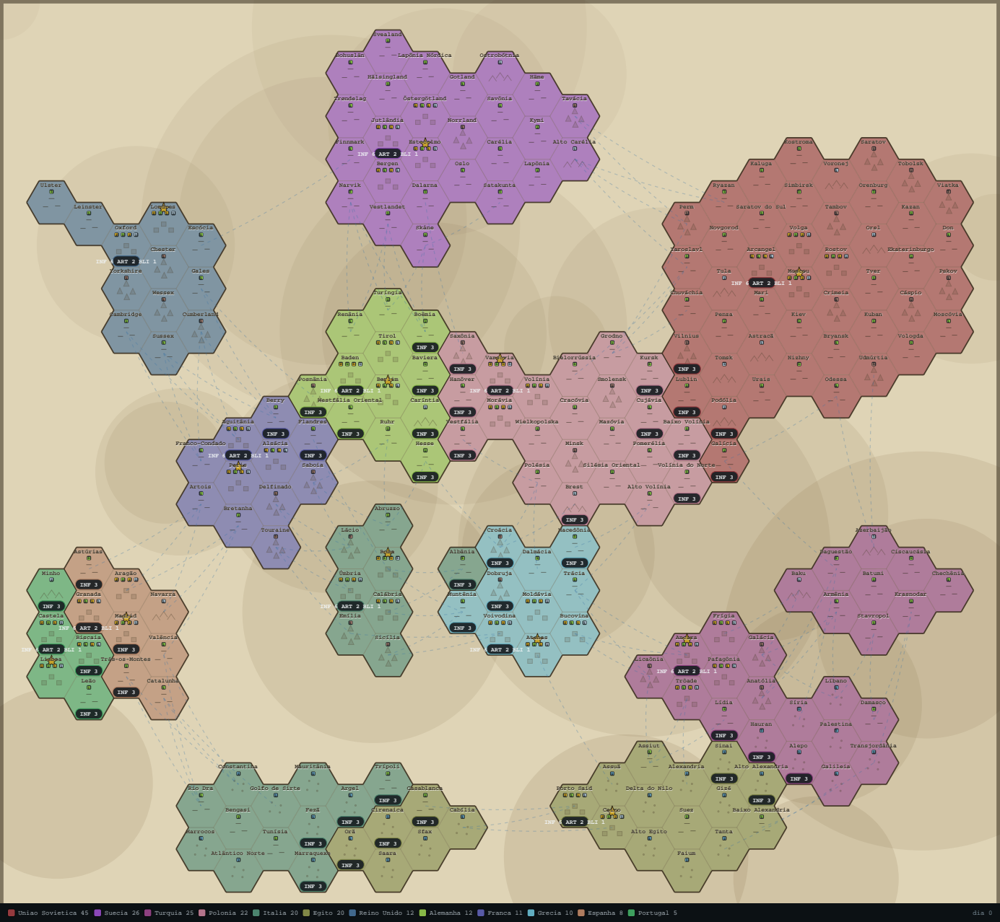
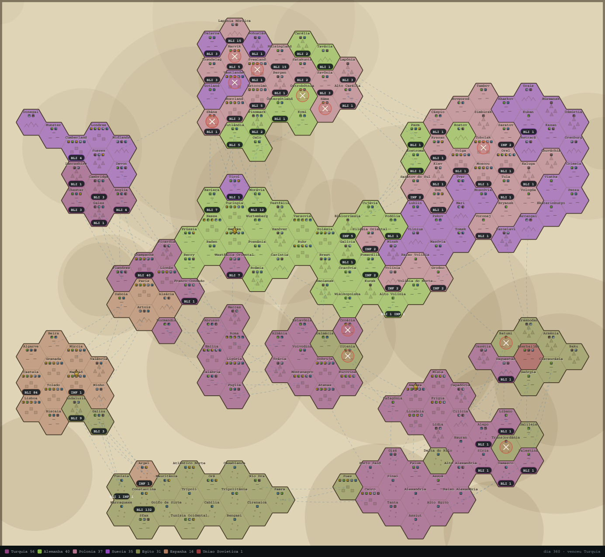

# Supremacia 1942

Jogo de grande estratégia ambientado numa Segunda Guerra ficcional, feito para
ser jogado **no navegador, sem instalar nada**. Você comanda uma de doze nações
numa Europa dividida, administra economia e exército, faz guerra (por terra e
por mar) e tem 360 dias para alcançar a supremacia.

Tudo aqui é original: o mapa, os nomes, as cores, as unidades, as regras e o
código. Nada foi copiado de jogo nenhum.



---

## Como rodar

```bash
npm install
npm start          # sobe em http://localhost:3000
```

Abre no navegador e pronto. Não há passo de compilação: o cliente é JavaScript
puro servido pelo próprio servidor.

```bash
npm test           # 61 testes do motor, do servidor e do cliente
npm run dev        # reinicia sozinho a cada alteração
```

---

## Como se joga

**Escolha uma nação.** As potências continentais (URSS, Suécia, Turquia,
Polônia, Itália, Egito) começam grandes e perdoam erros. As médias (Alemanha,
França, Reino Unido, Grécia) exigem atenção. Espanha e Portugal são o desafio:
pouco território, vizinhos apertados — mas crescem rápido quem se expandir.

**O tempo corre sozinho.** Um dia de jogo a cada dois segundos. Use
<kbd>Espaço</kbd> para pausar, <kbd>+</kbd>/<kbd>−</kbd> para acelerar até 4×, ou
o botão **+1 dia** para jogar turno a turno. Aperte <kbd>H</kbd> para abrir o
manual dentro do jogo.

**Clique numa província sua** para dar ordens:

- **Construir** — cada província tem espaço limitado. Fazenda dá alimento,
  siderúrgica dá aço, poço dá petróleo, mina dá carvão, centro comercial dá
  dinheiro, quartel libera o recrutamento, e fortificação aumenta a defesa.
  O terreno multiplica a produção: petróleo rende muito no deserto, aço nas
  montanhas, dinheiro nas metrópoles.
- **Recrutar** — precisa de um quartel. Quanto maior o quartel, maior a fila,
  menor o preço e mais rápida a formatura.
- **Mobilizar** — escolha quantas unidades vão, clique em *Escolher destino* e
  depois na província destacada: verde é marcha, vermelho é ataque, azul é
  travessia marítima.

**O jogo termina sempre.** Alguém vence por supremacia ao controlar 40% do mapa,
ou no dia 360 há um armistício e vence quem tiver mais território.

### O que o jogo não faz

Não existe pagamento, anúncio, conta ou servidor de terceiros. É uma partida
local: o servidor roda na sua máquina e o mundo é gerado por semente.

---

## Regras que dão identidade ao jogo

Estas quatro mecânicas são o que separa *Supremacia 1942* de um clone genérico
de estratégia por turnos:

**1. Logística é o teto do exército.** Cada unidade consome alimento todo dia.
Um império que recruta sem construir fazendas vê as tropas desertarem. Não há
como empilhar um exército infinito: ou a economia acompanha, ou as unidades
somem.

**2. Cerco corta o suprimento.** Enquanto uma província está em batalha ela
**não recebe reforço** e o **quartel não consegue recrutar** — a fila de
treinamento congela. Isso resolve o defeito clássico de jogos do gênero, em que
o defensor bombeia tropas para dentro da batalha e o cerco nunca acaba. Aqui,
quem é cercado precisa reagir fora ou perder a província.

**3. Defesa leva vantagem — e leva a sério.** Montanha, metrópole e floresta
multiplicam a defesa, e cada nível de fortificação soma +12%. Atacar exige
superioridade real. A IA só ataca com margem e o jogador aprende rápido que
números parecidos não bastam.

**4. Operação anfíbia.** Potências insulares não ficam presas na ilha: onde o
mar é o caminho mais curto, aparece uma rota azul pontilhada. Atravessar o mar
**consome o movimento inteiro do dia** e quem desembarca luta com a defesa
inimiga valendo 25% a mais. Assim, o Reino Unido tem a Mancha para invadir a
França, e a Suécia alcança o continente pelo Skagerrak.

---

## Arquitetura: por que o servidor decide tudo

O jogo é **autoritativo no servidor**. Isso não é detalhe de implementação: é a
decisão que define o projeto.

```
navegador  ──comando──▶  servidor  ──valida──▶  estado oficial
    ▲                        │
    └────── retrato ─────────┘   (o cliente só desenha; nunca calcula)
```

- `server/world.mjs` — gera o mapa: hexágonos, continentes, terreno, nações,
  províncias, travessias marítimas. Determinístico por semente.
- `server/simulation.mjs` — o motor de regras: produção, consumo, recrutamento,
  combate, cerco, conquista, diplomacia, inteligência artificial e vitória.
- `server/index.mjs` — serve os arquivos, mantém o relógio e conversa por
  WebSocket.
- `public/jogo.js` — desenha o que o servidor mandou, coleta cliques e envia
  comandos. **Não contém nenhum número do jogo.**

### O cliente não sabe quanto custa um blindado

Isso é literal. Quando o jogador seleciona uma província, o servidor envia o
catálogo inteiro junto do estado: preços já com o desconto do quartel, a lista
de construções possíveis, o alcance exato de cada tipo de unidade e o bônus de
desembarque. O cliente só pinta.

A consequência prática: **um cliente modificado não consegue trapacear**. O pior
que ele pode fazer é mandar comandos demais — e para isso existe limite de
frequência. Toda recusa vem com um motivo em português, que o jogador lê na
tela ("Essa província precisa de um Quartel para recrutar.", "Renânia está sob
cerco: não é possível reforçar até a batalha terminar.").

E existe uma garantia que vale a pena citar porque é fácil de quebrar sem
perceber: **um comando recusado não altera absolutamente nada no estado**. Há um
teste dedicado a isso (`nenhum comando recusado deixa marca no estado`), escrito
depois de um bug real em que as tropas sumiam da origem antes de a validação
terminar.

### Por que isso importa (e a ligação com o pedido original)

A conversa que originou este projeto começou com uma ideia de modificar o ouro
de um jogo online. A resposta foi não — e o motivo é exatamente o que este
código demonstra.

Naquele jogo, o dinheiro ficava no servidor. Mexer no cliente não daria ouro;
no máximo, faria o servidor recusar a partida. Não era uma questão de
dificuldade, era de onde o estado mora. **Quem guarda o estado, decide.** Este
projeto existe para mostrar o outro lado da mesma moeda: construindo o jogo, é
possível ver *por que* o servidor decide tudo — e por que isso é o que mantém a
partida honesta.

---

## Qualidade: o que os testes cobrem

`npm test` roda 61 testes, sem precisar de navegador.

**Motor (44 testes)** — geração determinística, territórios contíguos, simetria
dos vizinhos, economia (toda nação consegue produzir todos os recursos), custos,
validação de cada comando, cerco, travessias marítimas, armistício, supremacia,
e uma bateria de invariantes após 300 dias de simulação: estoques nunca
negativos, nenhuma província sem dono, ninguém eliminado continuando a controlar
território.

**Cliente (17 testes)** — o servidor real sobe, a página real é carregada num
DOM (jsdom), o cliente é executado de verdade e o teste verifica que ele se
conecta, desenha o mapa, escolhe nação, responde a cliques, troca de aba, abre o
manual e que **um clique em "pausar" chega de fato ao servidor**.

Dois bugs que só apareceram porque o teste carrega a página real:

1. `resolve()` trata `/index.html` como caminho absoluto do sistema e descartava
   a pasta pública — o servidor respondia **403 em tudo**. A prévia mostraria
   apenas "403".
2. `forcaTotal` somava as batalhas *dentro* do laço das províncias, multiplicando
   a força pelo número de províncias conquistadas. A IA ficava com números
   absurdos e declarava guerras sem sentido.

---

## Ferramentas

```bash
node tools/previa-mapa.mjs 200 1942 previas/meio-da-campanha.svg
```

Gera uma imagem do mapa sem abrir o navegador, usando a mesma geometria e a
mesma paleta do cliente. Serve para conferir o desenho e para documentar uma
campanha. As imagens em `previas/` foram feitas com ela.

---

## O mapa

216 províncias hexagonais, 12 nações, seis massas de terra desenhadas à mão
(Ibéria, França, Europa central, Escandinávia, Leste europeu, Rússia, Balcãs,
Itália, Anatólia, Levante, Norte da África, Egito) mais as ilhas Britânicas.
O litoral, as montanhas, os desertos e as metrópoles são gerados por semente:
a mesma semente sempre produz exatamente o mesmo mundo.



*Uma campanha completa, só com inteligência artificial: a Turquia terminou com
56 províncias depois de invadir as Ilhas Britânicas e a Escandinávia por mar,
enquanto seis nações desapareceram do mapa.*

---

## Requisitos

Node.js 20 ou mais novo. Uma dependência de execução (`ws`) e uma de
desenvolvimento (`jsdom`, só para os testes).
